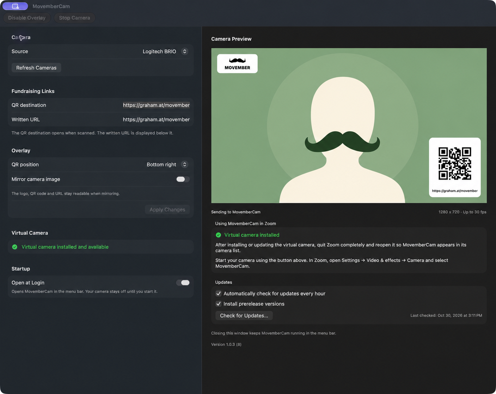

# MovemberCam

MovemberCam adds a fundraising QR code, a link, and the Movember logo to your camera feed. Choose MovemberCam as your camera in Zoom or another app that supports virtual cameras to show them during calls.

[Download the latest release](https://github.com/grahamgilbert/movembercam/releases/latest). Requires macOS 14 or later.

## Install

1. Open the downloaded DMG and drag **MovemberCam** into **Applications**.
2. Open MovemberCam and allow camera access when prompted.
3. Click **Install Virtual Camera** beneath the preview and approve the extension when macOS prompts you. Wait for **Virtual camera ready**, or follow the instructions to restart your Mac.
4. Choose your physical camera and enter your fundraising links in **QR destination** and **Written URL**. Click **Apply Changes**.
5. Quit and reopen your video app, then select **MovemberCam** as its camera. Keep MovemberCam running during calls. Your physical camera runs while Settings is open or a video app uses MovemberCam. Close Settings and stop using MovemberCam in video apps to release it.

After an app update, MovemberCam automatically updates an older enabled camera extension and checks that the camera becomes available. It pauses capture during replacement and resumes automatically if a video app still needs it. If macOS requests approval, open **System Settings → General → Login Items & Extensions → Camera Extensions** and enable **MovemberCam Camera**; choose **By Category** first if it is shown. On macOS 14, use **Privacy & Security** instead. Return to MovemberCam or click **Recheck Camera Status** to refresh approval. An enabled extension can still be waiting for macOS to finish connecting it. If the camera does not return, use **Retry Connection** and follow the restart guidance. Reopen your video app to discover updated camera formats. A disabled extension stays disabled.

## Using MovemberCam

The QR code destination and the URL displayed on screen can be different. Both default to [movember.com/t/musta-ch](https://movember.com/t/musta-ch); change them in Settings to use your own fundraising page.

You can place the QR card at the bottom left or right and mirror the camera image while keeping the QR code and text readable. Click **Apply Changes** to save changes to the links, position, and mirroring. Camera selection and the menu bar overlay toggle save immediately.

Use the mustache menu bar icon to open Settings, toggle the overlay, or quit. Turning off the overlay leaves the camera running while Settings is open or a video app uses it. Closing Settings also leaves the app running. The physical camera is released when Settings is closed and no app uses MovemberCam, or when you quit MovemberCam. A video app’s settings preview can also keep the camera active.

MovemberCam supports built-in, USB, and Continuity cameras. Built-in cameras use macOS’s normal high-quality video feed. For other cameras, Auto resolution chooses the highest resolution up to 4K at 30 fps, or the nearest available frame rate. The preview shows the actual capture dimensions. The virtual camera matches common camera resolutions, including 720p, 1080p, 1440p, and 4K; your meeting app can request a different output size. Zoom may mirror the text in your self-view, but other participants receive the readable overlay. Audio uses the microphone selected in your meeting app.

Settings also has **Open at Login**, automatic update preferences, and **Check for Updates…**. Opening Settings starts the camera for its preview. Launching at login keeps Settings hidden and leaves the camera off until a video app uses MovemberCam.

To remove the virtual camera, close apps using MovemberCam and choose **Camera → Remove Virtual Camera**.

## Development

See [Building and development](docs/DEVELOPMENT.md) for local preview builds, camera-extension signing, DMG packaging, tests, and architecture. [CI and releases](docs/RELEASING.md) covers GitHub Actions and publishing updates.

## Privacy

Video is processed on your Mac. MovemberCam does not upload video or visit your fundraising links. It checks this GitHub repository for app updates; your meeting app transmits the video during calls.

MovemberCam is an independent project and is not affiliated with Movember or Zoom. See [artwork credits](Resources/ATTRIBUTION.md).
